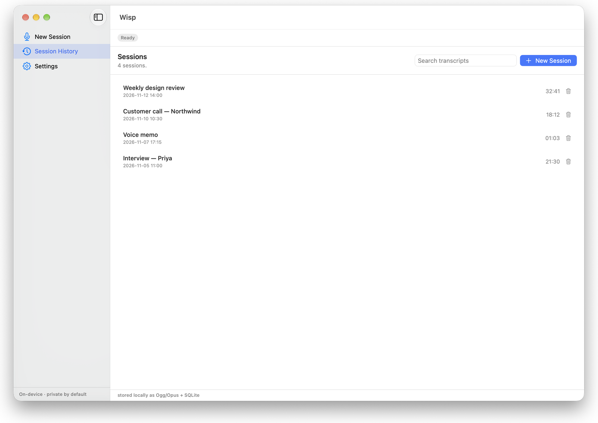
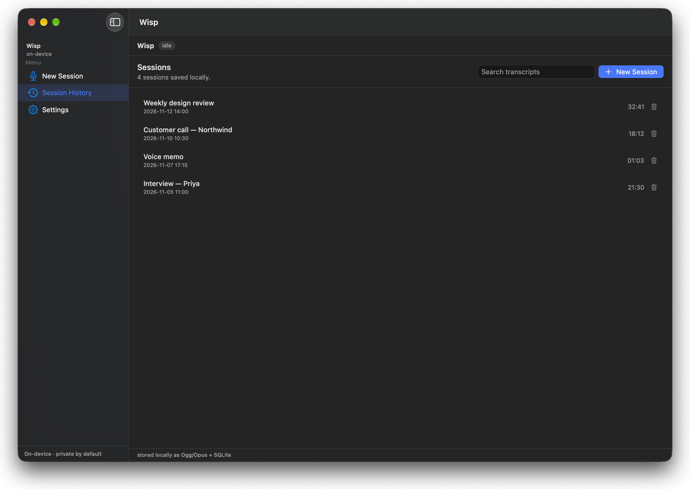
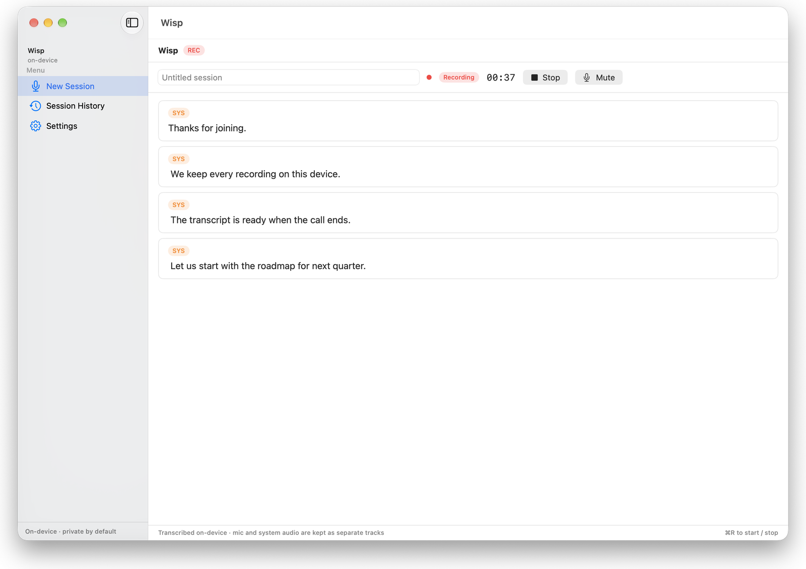
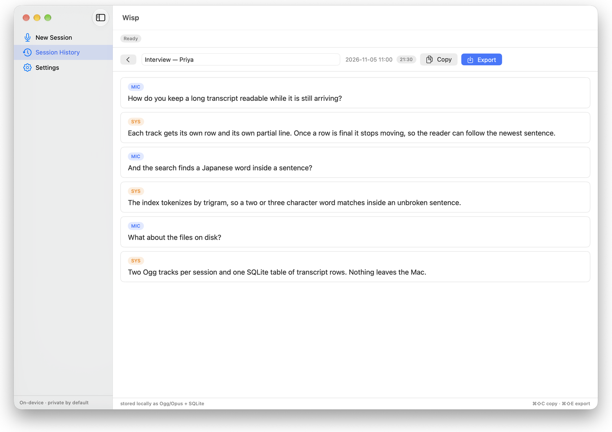

# Wisp

**A privacy-first recording & transcription desktop app for macOS.**

Wisp captures your microphone and system audio (the other side of a call) at
the same time and transcribes both on-device with Apple's `SpeechAnalyzer`.

---

## Features

- **Offline-first** — recordings and transcripts stay on your device. Nothing
  is uploaded; there is no online transcription service involved.
- **On-device transcription** — Uses [`SpeechAnalyzer`](https://developer.apple.com/documentation/speech), the new API in Apple's Speech framework. Both the microphone and the far side of the call are transcribed locally.
- **System audio + microphone capture** — Uses macOS 14.2+ [Core Audio Process Taps](https://developer.apple.com/documentation/coreaudio/capturing-system-audio-with-core-audio-taps). Each source is captured as a separate track.
- **Pure Swift** — Capture, transcription, storage, and the interface are one Swift package built on AppKit and SwiftUI. No embedded browser, no web assets, and no network at runtime.
- **Light and dark appearance** — Follows the macOS appearance by default. Change the preference on the Settings page (Follow System / Light / Dark). The choice is persisted in `settings.json` beside the local data.
- **Settings and transcription language** — <kbd>⌘,</kbd> or the sidebar opens Settings. Pick the speech language there; Apple's on-device model is downloaded for it on the next recording. The default stays `ja-JP`.
- **Meeting detection** — Off by default. When enabled, Wisp watches which apps hold the microphone and offers to record, or records automatically, per tool: Zoom, Microsoft Teams, Slack huddles, Webex, FaceTime, Discord, and browser meetings. A native app must hold the microphone for about two seconds, and a browser for twenty, so a voice note is not mistaken for a call.
- **Simple local storage** — Recordings are stored as Ogg/Opus and metadata as SQLite under `$WISP_DATA_DIR`, or `$HOME/Library/Application Support/dev.mokmok.wisp/` when the override is unset. Completed transcripts can be copied as plain text or exported as Markdown.

## Screenshots

The native interface — the session library in light and dark appearance, the
live recording screen, and a saved transcript.






## Architecture

Wisp is a single Swift package with the manifest at the repository root and
cleanly separated targets:

| Target | Source | Responsibility |
| --- | --- | --- |
| `WispDesktop` | `Sources/WispDesktop` | The SwiftUI app: windows, screens, menus, the session model, and the recording lifecycle. |
| `WispAudioKit` | `Sources/WispAudioKit` | Core Audio Process Tap capture, microphone capture, the Ogg/Opus recorder, and `SpeechAnalyzer` transcription. |
| `WispCore` | `Sources/WispCore` | Shared types (`Session`, `Segment`, IDs, `SourceLabel`), the meeting-tool catalog and policies, and `Settings`/`SettingsStore`. |
| `WispLifecycle` | `Sources/WispLifecycle` | The session lifecycle state machine and the guards that protect a live transcript. Pure, with no I/O. |
| `WispStorage` | `Sources/WispStorage` | Session/segment persistence on the system SQLite (`sessions.db`, WAL, FTS5). |
| `wispctl` | `Sources/wispctl` | A command-line harness for recording a session by hand. |

Tests live under `Tests/`, one directory per test target. Bundle metadata and the
icon tooling live in `App/`: `Info.plist`, `Wisp.entitlements`,
`AppIcon.icns`, and, for the `wispctl` helper app, `App/wispctl/`.

Roughly, data flows like this:

```
Core Audio Process Tap ─┐
                        ├─► WispAudioKit ─► SpeechAnalyzer ─► WispDesktop (SwiftUI)
Microphone input ───────┘        │                                  ▲
                                 └─► recordings (Ogg/Opus)          │
                                                                    └─► WispStorage (SQLite)
```

`WispCore` and `WispLifecycle` depend on Foundation only, so they build and test
anywhere Swift does. `WispAudioKit` and `WispDesktop` need the macOS 26 SDK and
the Core Audio/Speech frameworks.

## Requirements

- **macOS 26 (Tahoe)** — Wisp relies on `SpeechAnalyzer` and Core Audio Process Taps, so macOS 26 is required.
- **Swift 6** — from Xcode 26 or the Command Line Tools. Building the app bundle needs the full SDK; `swift test` needs XCTest, which ships with Xcode.
- Microphone and speech-recognition permissions. macOS will prompt on first launch.

## Setup and usage

On macOS, first launch shows the microphone and speech-recognition permissions
needed for capture and on-device transcription. The default speech language is
`ja-JP`; open Settings with <kbd>⌘,</kbd> or the sidebar to choose another
language. The choice applies to the next recording, and the model downloads on
first use.

Meeting detection is off until you enable it in Settings. Each tool can be set
to **Off**, **Ask**, or **Auto-record**. Wisp reads the microphone users from
Core Audio and never records audio until a session starts.

To record and review a session:

1. Select **New Session**, then **Record**. Wisp keeps microphone and system
   audio as separate tracks.
2. Use **Mute mic** when needed, then **Stop** to drain and finalize the
   recording.
3. Open a saved session from the library to review its transcript.
4. Use **Copy** for `[MIC]` / `[SYS]` plain text, or **Export** for a Markdown
   file with YAML frontmatter.

The application menu also provides these shortcuts:

| Action | Shortcut |
| --- | --- |
| Start / stop recording | <kbd>⌘R</kbd> |
| Copy transcript | <kbd>⌘⇧C</kbd> |
| Export transcript | <kbd>⌘⇧E</kbd> |
| Open Settings | <kbd>⌘,</kbd> |

## Build & run

A [Nix](https://nixos.org/) flake is included, so the dev environment is one command away:

```bash
# Enter the dev shell
nix develop
```

Then build and run the app:

```bash
# Build the ad-hoc-signed bundle and open it
nix build
open result/Wisp.app

# The CLI helper
nix run .#wispctl
nix build .#wispctl && open result/Wispctl.app
```

`nix build` assembles and ad-hoc signs `Wisp.app` from `App/Info.plist`,
`App/AppIcon.icns`, and `App/Wisp.entitlements`, with
`CFBundleShortVersionString` taken from the root `VERSION`. `.#Wisp-debug`
builds the same bundle from a debug binary. Signing happens inside the Nix
build sandbox, so the result is ready to `open` without a second step.

For a plain toolchain build without the bundle:

```bash
nix develop
swift build
swift run WispDesktop
```

The `default` dev shell provides `swift-format`, applies the macOS
Xcode/`DEVELOPER_DIR` handling automatically, and installs the project's
pre-commit `treefmt` hook on entry. If you use [direnv](https://direnv.net/),
the committed `.envrc` (`use flake`) does all of this on `cd`.

Formatting is unified through [treefmt-nix](https://github.com/numtide/treefmt-nix):
`nix fmt` (or `treefmt` inside the dev shell) formats Nix (`nixfmt`) and Swift
(`swift-format`) in one pass. `nix flake check` runs the same formatting as a
gate. Swift uses `swift-format`'s stock defaults — the repository commits no
formatter configuration, so upstream's style is the contract.

### Build caching

CI authenticates to
[FlakeHub Cache](https://flakehub.com/cache) through the repository's `setup-nix`
action, so flake outputs built in GitHub Actions are pushed to and pulled from
FlakeHub. Locally, `nix develop` / `nix build` pick up the same cache when
authenticated to FlakeHub (for example via
[Determinate Nix](https://docs.determinate.systems/)).

If you'd rather use Xcode directly:

```bash
swift build -c release
```

### Custom data directory

Set `WISP_DATA_DIR` to override where `sessions.db` and the `recordings/`
directory are stored. When unset, Wisp uses
`$HOME/Library/Application Support/dev.mokmok.wisp`. `HOME` must be available
unless `WISP_DATA_DIR` is set. Settings are stored as `settings.json`.

Wisp exits before recording if the durable database cannot be opened; it never
treats an in-memory fallback as successful persistence.

### Testing

`nix flake check` is the single entry point for every automated check. It runs
four attributes:

| Attribute | Proves |
| --- | --- |
| `checks.aarch64-darwin.treefmt` | Every Nix file matches `nixfmt` and every `Sources/`, `Tests/`, and `App/` Swift file matches stock `swift-format` |
| `checks.aarch64-darwin.build` | The whole package type-checks, including the SwiftUI app and the audio targets |
| `checks.aarch64-darwin.tests` | The XCTest suites pass. **Skips** when the active toolchain has no XCTest; see below |
| `checks.aarch64-darwin.pre-commit` | The pre-commit hook set evaluates and runs |

```bash
# everything
nix flake check

# one gate directly
nix build .#checks.aarch64-darwin.build

# what a gate actually did
nix log .#checks.aarch64-darwin.build
```

`WispCore`, `WispLifecycle`, and `WispStorage` carry the logic tests — ID
round-trips, the meeting catalog and policies, settings decoding, the lifecycle
reducer and its guards, and the storage round-trips, search cases, migrations,
and `finaliseSession` transaction. The audio targets are exercised by
`WispAudioKitTests`.

`swift test` needs XCTest, which Apple ships with Xcode rather than the Command
Line Tools. The `tests` check resolves the macOS SDK platform with `xcrun` and
type-checks a one-line `import XCTest` against it before running anything. On a
host where that probe fails the check **fails**, because `nix flake check` is the
only entry point and four green checks with zero executed tests is not evidence
of anything. Opt in explicitly when the host genuinely has no Xcode:

```bash
WISP_ALLOW_SKIPPED_TESTS=1 nix build --impure .#checks.aarch64-darwin.tests
```

The opt-out is read by Nix at evaluation time, not by the builder's shell, so
`--impure` is required — plain `nix flake check` never sees the variable and
always keeps the fail-closed default. That path records
`skipped: XCTest is not available to the Swift compiler` in `$out/status`. Every
other failure — a compile error, a failing test, or a run that executes no suite
— fails the check regardless of the opt-out. CI runs the
same check on `macos-26` with Xcode installed, so the suites execute there.

## Contributing

Issues and pull requests are welcome. Before sending a PR, run `nix flake
check`, the single local entry point for these checks. It fails on a formatting
diff, a compile error, or a failing test.

If you want the individual commands the gates run — for example to iterate on one
of them — the dev shell has the same toolchain:

```bash
swift-format lint --recursive Sources Tests App
swift build
swift test
```

See [`docs/verification.md`](docs/verification.md) for what each gate proves and
which checks still need a person on macOS.

## Roadmap

- [x] Copy transcript to clipboard (plain text) and export as Markdown (`.md`) with a lightweight, CloudEvents-inspired YAML frontmatter envelope (`id`, `type`, `source`, `time`, `subject`, …).
- [ ] Export to SRT / JSON.
- [ ] Speaker diarization within a single channel.

## License

TBD (will be added before public release).
